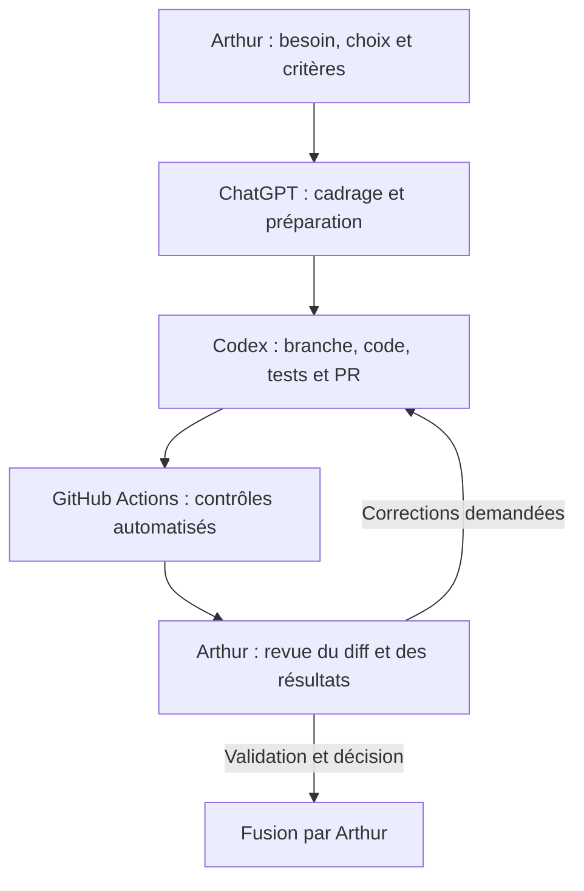

# Développement assisté par agents IA

TerriMaint, projet de formation Concepteur Développeur d’Applications, utilise
ChatGPT et Codex dans un processus de développement suivi sur GitHub.
Le dépôt permet d’examiner le passage d’un besoin métier à une modification testée,
avec des contrôles automatisés et une décision humaine de fusion.

## Organisation du travail

| Intervenant | Responsabilité |
| --- | --- |
| Arthur | Définit les besoins, les choix techniques et les critères d’acceptation. |
| ChatGPT | Aide au cadrage, à la réflexion et à la préparation des tâches. |
| Codex | Contribue à l’implémentation, aux tests et à la documentation dans des branches et PR. |
| GitHub Actions | Exécute les vérifications automatisées et conserve leurs résultats. |
| Arthur | Examine les modifications, vérifie les résultats et décide de la fusion. |

Les flèches décrivent des étapes de travail, pas une orchestration automatique des outils.
Les [consignes des agents](../AGENTS.md) et le [workflow détaillé](workflow.md)
fixent les règles opérationnelles.

## Exemple vérifiable : terminer une intervention

La [PR #82](https://github.com/arthurb1348/terrimaint/pull/82) ajoute une règle métier :
l’agent présenté peut terminer une intervention qui lui est assignée et qui est
En cours, sans clôturer son signalement d’origine. Elle associe implémentation,
confirmation accessible, tests des refus (autre agent, statut incompatible, second clic)
et vérification du statut partagé entre les espaces Agent et Responsable.

- La [CI](https://github.com/arthurb1348/terrimaint/actions/runs/42360236813)
  a réussi : contrôles Backend et Frontend, dont lint, **361 tests unitaires frontend** et build.
- Le [workflow Responsive](https://github.com/arthurb1348/terrimaint/actions/runs/42360236816)
  a réussi : deux lots de tests navigateur, rapport commun et contrôle final.
- La checklist de validation de la PR est cochée ; Arthur a fusionné la modification
  le 7 novembre 2026. La réussite automatique ne démontre pas à elle seule un essai sur Pixel.

Preuves vérifiées le 7 novembre 2026 : Backend/Frontend ont contrôlé la tête `244337e` ;
Responsive a contrôlé le commit de fusion de test `3adc9fa`.

## Améliorer aussi le processus

La [PR #75](https://github.com/arthurb1348/terrimaint/pull/75), fusionnée,
formalise le choix des tests locaux selon les comportements et dépendances touchés,
limite les relances sans information nouvelle et conserve la validation complète en CI.
Elle ajuste les consignes sans modifier les tests ni les workflows.
La [politique de validation](workflow.md#validation-locale-et-ci) reste la référence détaillée.

## Périmètre de cette pratique

Il s’agit d’un workflow de développement assisté par agents, piloté par Arthur.
TerriMaint ne met pas en œuvre une plateforme multi-agents autonome ni une orchestration
applicative LangGraph. L’usage de ces outils pendant le développement ne constitue
pas une fonctionnalité d’IA générative intégrée à l’application.
